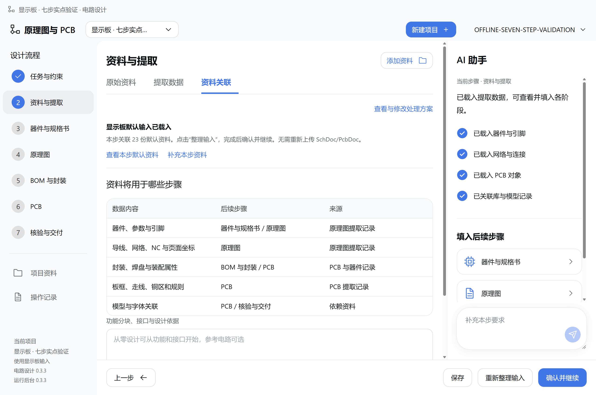
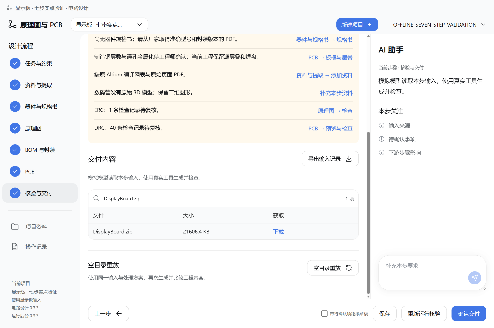

# 电路设计 0.3.3：显示板七步原生窗口验证

2026-10-14 在安装后的 0.3.3 独立 Electron 窗口中新建显示板项目，通过实际界面点击完成七步并生成工程。2026-10-15 同步验证证据；安装包保持原有 0.3.3。安装和运行版本核对见[更新说明](update-eda-flow-0.3.3.md)。

## 结果

| 步骤 | 实际操作与结果 | 确认方式 |
| --- | --- | --- |
| 1 任务与约束 | 使用默认输入，保存并确认；模型请求为零 | 直接确认 |
| 2 资料与提取 | 点击整理输入；第一步保持确认，输出哈希不变 | 直接确认 |
| 3 器件与规格书 | 读取并核对，显示缺少规格书 | 带待确认项继续草稿 |
| 4 原理图 | 生成原理图、检查并打开图纸预览与放大窗口 | 带待确认项继续草稿 |
| 5 BOM 与封装 | 生成物料表、封装库和映射检查 | 带待确认项继续草稿 |
| 6 PCB | 实际生成 PCB、正反面二维和三维预览 | 带待确认项继续草稿 |
| 7 核验与交付 | 28 类基准比较一致，下载工程 ZIP | 带待确认项确认交付 |

- 共访问 21 个步骤页签；创建项目 1 次、执行 6 次、确认 7 次，没有重复创建项目。
- 第一步的确认状态与输出哈希在全部下游步骤中保持不变；刷新后仍为七步已确认。
- 工程 ZIP 含 112 个文件，编译网表含 41 个器件、25 个网络。下载文件与后台生成文件哈希一致。
- 12 次模型响应来自测试替身，真实/付费模型请求为零。KiCad、Python、ERC/DRC 和三维渲染均实际执行。测试运行在独立目录，未修改正常 Harness 的项目或模型配置。
- 最终仍有规格书、制造铜层数与通孔金属化、原 AD 编译网表和页面 PDF、数码管原始三维模型等待补充；ERC 1 条、DRC 40 条待复核。七步可操作和生成通过，不代表工程正式签核。

第 4–5 步的阶段记录保留当时的 82 条 ERC 检查记录；第 6–7 步重新检查得到最终 1 条 ERC 记录，二者属于不同阶段输出。

## 截图

第二步执行后，第一步仍已确认；页面与后台均为 0.3.3：



最终七步均已确认，工程 ZIP 可下载，待确认项继续显示：



## 证据与范围

[机器可读验证记录](../plugins/dsh-eda-flow/evals/seven-steps-0.3.3.json) · [证据 ZIP](../output/packages/EDA_Flow_0.3.3_SevenStep_Verification.zip) · [证据 SHA-256](../output/packages/EDA_Flow_0.3.3_SevenStep_Verification.sha256.txt)

证据包包含脱敏后的逐步记录、界面操作记录、生成物检查和本次截图，不包含登录、窗口会话密钥或用户配置。生成工程的 SHA-256 为 `7788296a641031d4cf9a6836215ce8c98e86d79b7b7646943e6b9974cf66ca19`；工程本体保留于本机验证目录，未打入证据 ZIP。

七步执行已完成后，原测试驱动等待 Playwright 的网页下载事件超时，但 Electron 原生下载已完成。随后在同一项目中以 Electron 原生事件验证下载和刷新，未重新生成或重新确认。已保存脚本改用原生事件，并允许通过 `PLAYWRIGHT_PACKAGE` 指定自动化依赖。此轮没有点击“空目录重放”；此前重放记录不算作本次新执行。

## 重跑方法（可选，不是更新安装步骤）

使用 [desktop-seven-steps.mjs](../plugins/dsh-eda-flow/test/desktop-seven-steps.mjs)，依次传入新的输出目录、已安装插件目录、Electron、KiCad Python 和 KiCad CLI。运行前本机需已安装 Playwright；脚本默认解析 `playwright` 包，也可用环境变量指定其绝对目录。

```powershell
$env:PLAYWRIGHT_PACKAGE = 'D:\工具\playwright\driver\package'
node .\plugins\dsh-eda-flow\test\desktop-seven-steps.mjs `
  'D:\验证\显示板-新一轮' `
  "$env:USERPROFILE\.dsh\profiles\desktop\node_modules\dsh-eda-flow" `
  'D:\已有窗口运行时\electron.exe' `
  'D:\KiCad\bin\python.exe' `
  'D:\KiCad\bin\kicad-cli.exe'
```

上方工具路径需替换为本机实际路径，输出目录必须尚不存在。脚本自己创建模拟模型服务，不读取或修改正常 Harness 登录及模型设置，执行真实生成工具并输出截图、检查记录与工程包。原始测试目录包含短期窗口会话文件，不要整目录公开上传。
