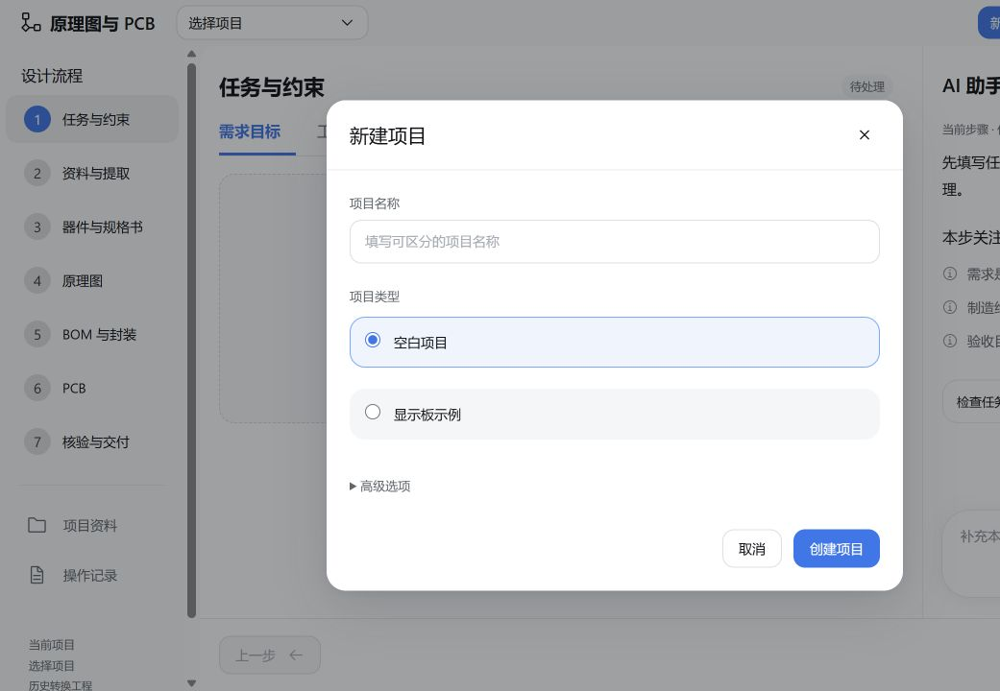

# EDA Flow 0.9.5-beta.5

新建项目默认只显示 **空白项目** 和 **显示板示例**。显示板示例自动提供可编辑任务书和模拟 DOCX，沿用通用设计流程。

“高级选项”默认折叠，保留固定器件清单导入、旧版模拟提取、简短需求、固定原器件重设计、历史原图复原。已有项目继续按原模式读取，创建参数及存储格式不变。保留 DOCX 输入、SQLite 记录修复、图纸预览、完整工程下载及所有原检查功能。

## 更新

退出 Harness，在原测试分支执行：

```powershell
git pull --ff-only
# 稀疏检出用户执行
git sparse-checkout add intranet/eda-flow-0.9.5-beta.5
powershell -NoProfile -ExecutionPolicy Bypass -File .\intranet\eda-flow-0.9.5-beta.5\scripts\update-eda-flow.ps1 -Profile desktop
```

将 desktop 替换为实际 profile，更新后重启 Harness。保留已有工程目录、模型配置和其他插件。首次安装请先使用 [完整运行环境](../eda-flow-0.9.5-beta.1/README.md)。

## 界面



## 验证

- 42 项测试通过：入口映射、界面结果、历史项目迁移及读取、DOCX、确认状态、CAD/BOM 核验、工程下载和记录存储。
- 实际浏览器验证空白项目与显示板示例创建、高级选项折叠、固定器件导入入口及主/高级选项互斥。
- 前端构建、语法检查通过；包内 230 个源码文件与工作目录逐字节一致。
- 更新脚本通过隔离环境的包管理器替身测试，保留原配置。

