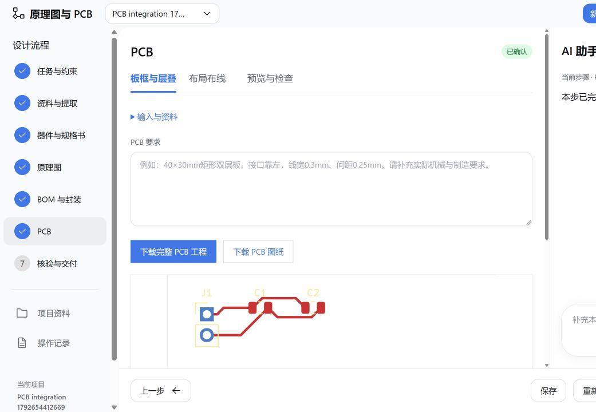

# EDA Flow 0.9.5-beta.6

- **待确认项即时回答**：直接输入，提交后立即核对；显示已解决或具体缺项。答案跨步骤继承，刷新和重启后仍保留。资料变化时重新核对，设计变化时标记下游失效。原理图和 PCB 最终确认保留。
- **实际 PCB**：第六步填写自然语言要求后生成可编辑矩形双层 PCB，完成自动布局、Freerouting 布线和 KiCad DRC。工程、PDF 和预览就在本步下载；DRC 失败不能确认，确认后 PCB 纳入最终交付。
- 新建仍只有空白项目、显示板示例，旧入口保留在高级选项；DOCX、SQLite 记录、原理图和 BOM 功能保留。

## 更新

退出 Harness，在原测试分支执行：

```powershell
git pull --ff-only
# 稀疏检出用户执行
git sparse-checkout add intranet/eda-flow-0.9.5-beta.6
powershell -NoProfile -ExecutionPolicy Bypass -File .\intranet\eda-flow-0.9.5-beta.6\scripts\update-eda-flow.ps1 -Profile desktop
```

将 desktop 替换为实际 profile，再重启 Harness。更新脚本保留项目、模型与登录配置，额外解压并配置此目录的 Java 21 离线运行环境；不更改系统 Java。已有 Java 21 可用 `-JavaPath 'C:/path/to/java.exe'` 指定。KiCad 自带 Python 默认从 kicadCli 同目录定位；非标准安装可在插件设置填写 pcbPython 和 kicadFootprintRoot。

PCB 使用当前原理图的真实封装。显示板资料中若只给封装标识、没有可读取的焊盘几何，页面会具体列出缺失器件，补充后继续；不以近似封装代替。支持矩形双层板；其他板形与层数仍需补充对应能力。

首次安装请先使用 [完整运行环境](../eda-flow-0.9.5-beta.1/README.md)。

## 验证

共60项测试通过：交互、持久化、重试、取消、重复提问过滤、旧项目读取及原工程下载已通过回归。PCB 使用测试模型控制流程，真实调用 KiCad 和 Freerouting：供电接口与两颗去耦电容，40×30mm 双层板，0 DRC 错误、0 未连接。覆盖受保护 JSON 请求、DRC 失败拦截及重复生成交付包；未调用付费模型。




## 开源组件

[Freerouting 2.1.0](https://github.com/freerouting/freerouting/tree/v2.1.0) 未修改二进制随插件提供，GPL-3.0 许可证位于插件 vendor。对应源码在本目录 vendor/freerouting-2.1.0-corresponding-source.zip，包含源码、资源和构建脚本，未含集成应用二进制和测试板数据。Java 离线包包含 Temurin 21 运行库及 legal 目录，来源为 [Eclipse Temurin](https://adoptium.net/temurin/releases/)。

包内237个源码文件逐字节核对通过；更新脚本在隔离配置和包管理器替身环境通过，保留原配置；第六步工程ZIP含37文件，第七步含PCB的工程ZIP含62文件，JSON导出均可解析。
