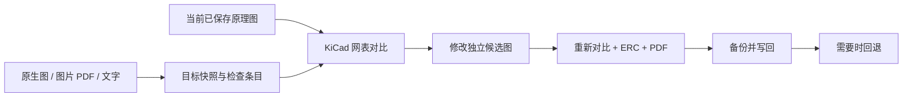

# dsh-schematic-sync

让 DeepSeek Harness 检查 **当前 KiCad 原理图与目标是否一致，并按目标修改**。适配 DSH `0.2.0-rc.2`、Node.js ≥ 22.19.0，本机已用 KiCad **10.0.6** 联调。复用 Harness 的 DeepSeek 对话和工具调用；不需要给插件再配置一份 DeepSeek Key。

## 三种目标

| 输入 | 工作方式 | 结论范围 |
|---|---|---|
| `.kicad_sch` | KiCad 导出双方实际网表，核对器件、属性、装配状态、逐脚网络；另比较图形结构 | 单页原生目标可检查电气及图形结构一致性，并自动同步 |
| 图片 / PDF | 渲染指定页；视觉服务或 DSH 会话视觉工具读取，提取带页号和证据的目标条目 | 核对已识别条目；读不清的脚号/连接保持 unknown，不宣称整图等同 |
| 文字 / TXT / Markdown | DeepSeek 将原文整理成器件和连接要求，每条保留逐字原文证据 | 核对明确提出的要求，其余电路保持原样 |

所有判断基于**已保存的原理图文件**。本插件是 DSH 插件，不是 KiCad 菜单插件；不读取 KiCad 未保存的编辑缓冲区。多页层级图可导出比较整个网表；v0.1 的自动修改和写回针对单页原理图。

## 安装与配置

```powershell
dsh plugin --profile web add 'D:\VisualBoard\dsh-plugins\dist\dsh-schematic-sync-0.1.1.tgz'
```

`web` 替换为实际 DSH profile。在该 profile 的 `cordis.patch.yml` 里配置已插入的插件，重载该 profile：

```yaml
- id: schematic-sync
  config:
    workspaceRoot: 'D:/VisualBoard'
    workDirectory: 'D:/VisualBoard/dsh-schematic-sync/workspaces'
    kicadCli: 'D:/Kicad/bin/kicad-cli.exe'
    python: 'D:/anaconda/python.exe'
    allowApply: true
    visionBaseUrl: ''
    visionModel: ''
    visionKeyEnv: SCHEMATIC_VISION_API_KEY
```

首次安装的默认 `allowApply:false` 可以对比、修改副本和验证；上面的实际配置开启写回能力。`workspaceRoot` 限制可选择的源文件；每个任务有独立 UUID 和独立候选文件，不会覆盖另一个聊天的任务选择。

图片/PDF 渲染需要：

```powershell
python -m pip install pymupdf
```

自动识图默认使用 **DSH 当前默认模型**，沿用 DSH 的登录与附件服务，无需额外 API Key。仅在模型明确声明支持图片时发送选中页面；切换为纯文字模型时会说明原因。工作台的识别按钮每次都会重新检查模型，识别完成后显示条目和待确认事项，草稿经人工核对保存后才进入对比。

也可显式配置独立的 OpenAI Chat Completions 视觉服务：`visionBaseUrl`、`visionModel`，以及启动环境中的 `SCHEMATIC_VISION_API_KEY`。显式配置优先；配置不完整时不会悄悄切换服务。密钥不会写入报告。独立 CLI 不挂载 DSH 模型，需配置此服务或导入条目。

识别结果会验证结构、证据页码和必需字段；响应截断、登录失效或模型不支持图片会报错。看不清的值、未标引脚和遗漏连接必须列为待确认，阻止写回。图片识别不能证明整图一致，PDF 可提取文字也不能证明线段连通。

## 在 DeepSeek 里直接这样说

原生目标：

> 使用 schematic-sync。当前图是 D:/项目/Board.kicad_sch，目标图是 D:/项目/参考/Target.kicad_sch。检查器件、阻容值、DNP 和逐脚网络差异。按照目标修改，保留同位号的 PCB 关联，验证后应用。当前 KiCad 工程已保存并关闭。

图片/PDF：

> 按 D:/项目/目标.pdf 第 1 页检查 D:/项目/Board.kicad_sch。先读取目标并列出识别到的元件、脚号、连线及不确定项，再修改候选图；有不确定项时不要猜，说明具体页号和位置。逐脚核对并运行 ERC。

文字：

> 检查 D:/项目/Board.kicad_sch：R1 改为 10k，C1 改为 100nF，R9 不装，U1 的 3 脚必须直接连接 J1 的 2 脚。按这些要求修改并验证；其他未提及连接保持原样。

## 工具流程



| 工具 | 用途 |
|---|---|
| `schematic_capabilities` | 能力、配置状态和输入约定 |
| `schematic_begin` | 指定 `currentPath` 和 `targetPath` / `targetText`，创建任务 |
| `schematic_read_target` | 原生目标数据、原文，或 `page` 指定页的 PNG/文字；`interpret:true` 可调用视觉服务 |
| `schematic_define_target` | 保存证据明确的文字/图像检查条目，绑定目标 SHA256 |
| `schematic_inspect` | 查看 current/candidate/target 的实际网表、元件坐标、UUID 和原始对象 |
| `schematic_compare` | 检查 current 或 candidate 与目标的差异 |
| `schematic_prepare` | 自动同步原生目标或修改已有元件属性；也接收增删件/改连线的结构化 patch |
| `schematic_verify` | 重新核对、ERC、PDF 预览与 JSON 报告，返回验证 token |
| `schematic_apply` | 带验证 token 写回，先做完整原始文件备份 |
| `schematic_rollback` | 恢复写回前的原始字节；后续有人工修改时拒绝覆盖 |

模型每次操作必须携带本任务 `taskId`。prepare 使用**候选**的 `revision`，define 使用 `targetRevision`，apply 使用 verify 的 `token`。

## 目标条目示例

```json
{
  "schemaVersion": 1,
  "scope": "partial",
  "requirements": [
    {
      "id": "R1-value",
      "kind": "component",
      "ref": "R1",
      "properties": {"value": "10k", "dnp": false},
      "certain": true,
      "evidence": {"quote": "R1 改为 10k，必须装配"}
    },
    {
      "id": "U1-J1",
      "kind": "connected",
      "pins": [{"ref": "U1", "pin": "3"}, {"ref": "J1", "pin": "2"}],
      "exact": true,
      "certain": true,
      "evidence": {"quote": "U1 的 3 脚只连接 J1 的 2 脚"}
    }
  ],
  "unresolved": []
}
```

还支持 `absent`（指定 ref 必须不存在）和 `disconnected`（两个指定脚不能同网）。`exact:true` 检查整组网络端点完全相等；省略时允许同网上还有其他器件。串联电阻两端不会因为直流可导通而合并成同一网络。

图片/PDF 的 `evidence` 需要 `page` 和可见证据 `quote`，先用 read_target 读取对应页。文字引用必须逐字出现在输入原文。`certain:false` 或 `unresolved` 非空时验证不会放行写回。型号、值、网络名采用精确字符串比较，不会擅自把 `AGND` 与 `GND`、`10k` 与 `10K` 当成相同目标。

## 修改能力

原生单页目标可自动同步整张图，包括缺件、多件、连线、标签、图形和内嵌符号。相同 `ref + unit` 的元件保留当前 UUID，保留当前根 UUID，并更新工程实例路径，减少对既有 PCB 关联的影响。PCB 文件本身不修改。

文字/图像目标可自动改已有元件的 Value / Footprint / DNP。增删元件、替换符号和改连线由 DeepSeek 根据差异生成下面的 patch，在独立候选图上执行，再重新导出网表验证：

```json
[
  {"op":"set_properties","ref":"R1","properties":{"Value":"10k","dnp":false}},
  {"op":"replace","uuid":"原线段UUID","sexpr":"(wire (pts (xy 10 10) (xy 20 10)) (stroke (width 0) (type default)) (uuid \"原线段UUID\"))"},
  {"op":"delete","uuid":"待删除对象UUID"}
]
```

`insert` 插入一个完整顶层对象（元件、wire、label、no_connect 等，带唯一 UUID）；`upsert_library_symbol` 插入或替换一个内嵌库符号。未修改对象保留原文。新元件必须有正确库定义、引脚及 instances，连线必须落在真实引脚坐标；可结合现有 KiCad MCP 查询脚位。变更同一对象时使用 `replace` 并保留 UUID。对于复杂图像目标，可能需要多轮 prepare/verify 才能满足全部连接要求。

## 验证与写回

- 当前文件、目标、子图和同目录项目/符号库文件有内容哈希；资料改变后要求重新开始任务。
- 候选变化或目标条目改变会使之前的验证 token 失效。
- 文字/图片的部分要求之外，未声明的元件增删、属性变化或其他引脚连接变化会阻止应用。若一次连接变更牵涉原网上其他引脚，需要明确列出全部受影响端点。
- `canApply:true` 要求：目标条件全部满足、没有未知项、KiCad ERC **error=0**。warning 数量另行报告，不等同于零警告。
- 原生目标同时要求图形结构相同；忽略用于身份关联的 UUID 和实例路径。该检查不是截图相似度检测。
- 写回要求 KiCad 工程先保存并关闭；检测到 KiCad 锁文件时拒绝。独立进程写回同一文件时使用排他锁。
- 备份和写回日志保存在 `workDirectory/<taskId>/`。先备份、记 pending 日志，再同目录原子替换。中断后可用 rollback 恢复已替换文件。
- 发生进程强制退出而留下 `.schematic-sync.lock` 时，先确认原进程已退出并查看 `pending-apply.json`，再清除该锁进行恢复，避免两次写回重叠。
- 验证导出 PDF 供人工看图；程序不把“PDF 可导出”说成“布局已人工审查”。不会验证实际硬件行为。

自动同步使用目标内嵌的符号；当前工程外部库注册不随原理图一起写回。目标引入不同外部符号库或封装时，应配置相应库，再在 KiCad 中检查后续“从库更新符号”和“从原理图更新 PCB”。

## 命令行与开发

无需启动 DSH 就能测试引擎：

```powershell
npm install
npm test
npm run verify:live
npm pack

node src/cli.js begin --config examples/config.json --current DisplayBoard.kicad_sch --text '将 R1 改为 330Ω'
node src/cli.js read-target --config examples/config.json --task '<taskId>'
node src/cli.js define --config examples/config.json --task '<taskId>' --revision '<targetRevision>' --json contract.json
node src/cli.js inspect --config examples/config.json --task '<taskId>' --which candidate
node src/cli.js prepare --config examples/config.json --task '<taskId>' --revision '<candidateRevision>'
node src/cli.js verify --config examples/config.json --task '<taskId>'
node src/cli.js apply --config examples/config.json --task '<taskId>' --token '<token>'
node src/cli.js rollback --config examples/config.json --task '<taskId>'
```

`verify:live` 依赖当前工作区的 `DisplayBoard.kicad_sch`、符号库和本机 KiCad；只在 `verification/时间戳/` 的测试副本上写回，不修改原始板图。可用 `KICAD_CLI` 指定其他 CLI 路径。

测试包括真实 DSH 工具注册/调用、解析和 patch、逐脚网络比较、证据及未知项校验，以及真实 KiCad 文件的差异检测、修复、ERC、PDF、写回回退、过期验证拒绝和图像/PDF 输入。现已通过 DSH 当前图片模型及本机登录完成真实 JPEG 识别联调；模型误读和不完整条目会留待人工核对，不会自动确认。独立外部视觉接口的线上兼容性尚未实测。

实现参考 KiCad 官方 [CLI 文档](https://docs.kicad.org/10.0/en/cli/cli.html) 和 [S-expression 原理图格式](https://dev-docs.kicad.org/en/file-formats/sexpr-schematic/)，DSH 接口以本机 `0.2.0-rc.2` 的实际类型与运行时测试为准。
